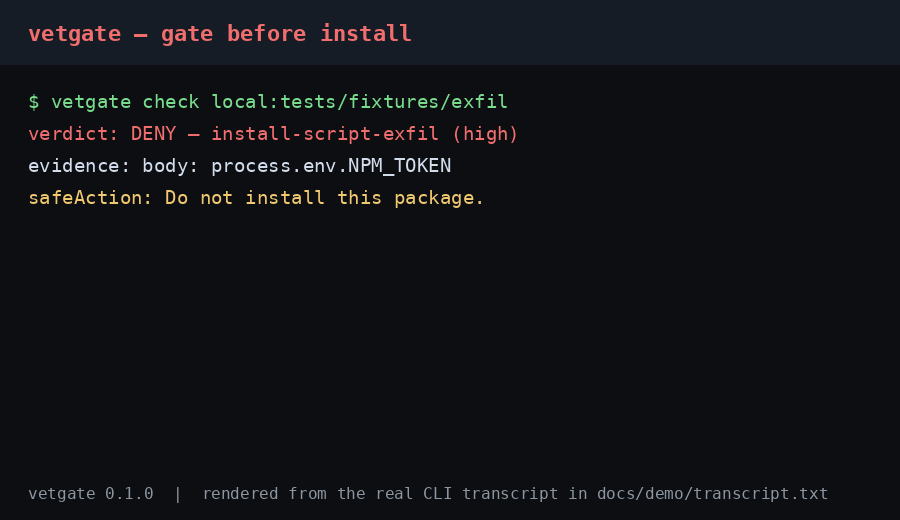

# vetgate

A local, deterministic pre-execution gate for software an agent is about
to install. Call it **instead of** running the install: one call, one
verdict (`ALLOW`, `DENY`, or `REVIEW`), every finding carrying the exact
evidence string it matched, and a manifest that makes the verdict
re-checkable without re-running anything.

If your coding agent installs packages, actions, or scripts on your
behalf, each install runs unreviewed — vetgate is the check that runs
first.



The demo is rendered from the real CLI transcript in
[docs/demo/transcript.txt](docs/demo/transcript.txt).

vetgate vets three kinds of artifact, as an MCP server and as a CLI
mirror:

| Tool / command | Input | What it does |
| --- | --- | --- |
| `vet_package` / `npm:name@version` | npm name and exact version | Downloads the published tarball, inspects it, never executes it |
| `vet_action` / `action:owner/repo@ref` | GitHub Action ref | Local form check only: SHA-pinned, mutable tag, or unpinned |
| `vet_script` / `url:https://...` | Script URL | Fetches the text (10s timeout, 1MB cap), scans it, never executes it |

Zero runtime dependencies beyond the MCP SDK. No model calls, no
account, no API key. The default path sends nothing anywhere except
downloading the artifact itself (`vet_package`) and fetching the script
text (`vet_script`, which is labeled in the verdict manifest). All
analysis is local.

## The moment it gates

An agent that installs a package runs its `postinstall` hook before
anyone reads any output. Post-install audits, PR checks, and dashboards
all sit on the wrong side of that moment: by the time they run, the
payload has already fired. vetgate sits before execution: the agent
calls it, reads the verdict, and only then decides whether to install,
install with `--ignore-scripts`, pin to a digest, or ask the user.

## The verdict

```json
{
  "verdict": "ALLOW | DENY | REVIEW",
  "artifact": { "kind": "npm-package", "name": "react", "version": "18.3.1", "sha256": "…" },
  "findings": [
    { "rule": "install-script-exfil", "severity": "high",
      "evidence": "body: process.env.NPM_TOKEN", "signal": "local" }
  ],
  "manifest": { "rulesVersion": "2026.10", "checkedAt": "2026-10-26T00:00:00.000Z", "signals": ["local"] },
  "safeAction": "Do not install this package. …"
}
```

Rules for the verdict itself:

- Any `high` finding means DENY. Otherwise any finding means REVIEW.
  No findings means ALLOW.
- REVIEW findings never DENY on their own. A single weak signal (an
  install script that only echoes, a missing license field, a mutable
  tag) yields REVIEW with a `safeAction`, never a silent ALLOW and never
  a DENY.
- Every finding carries its evidence string, truncated to 120
  characters. A finding without evidence is a bug.
- Determinism: same input bytes plus the same rules version give the
  same verdict, except for `manifest.checkedAt`. See "Measured numbers"
  for the determinism check.

### Content hash

`vetPackageContents` (the direct-contents API) sets `artifact.sha256`
to the SHA-256 of the concatenated file contents, with files ordered by
sorted filename, no separators, and no filenames mixed in. The MCP
`vet_package` tool and the CLI `npm:` spec replace that value with the
SHA-256 of the downloaded tarball bytes, which is the verifiable
registry artifact hash.

### Script fetch labeling

For `vet_script`, fetching the script text is itself a network fetch.
The verdict manifest carries a note saying exactly that: the text was
fetched over the network to perform the check, while all analysis was
local and the script was never executed. The `signal` on every finding
remains `local`.

## Rules (v1)

The full rule set, with patterns and triggering fixtures, is documented
in [docs/RULES.md](docs/RULES.md). Summary:

DENY:

- Install script, scanned `.js` / `.sh` file, or remote script text that
  reads a credential or environment value AND sends data to the network
  in the same text.
- Download-and-execute chains: `curl|sh`, `curl|bash`, `wget|sh`,
  `wget|bash`, `curl|node`, PowerShell `IEX` with an `http(s)` URL.
- Obfuscation markers (`eval(atob(`, base64-then-`eval`,
  `String.fromCharCode` with 10+ arguments, dense `\x` hex escapes)
  combined with a network call.
- Typosquat: package name at Levenshtein distance exactly 1 from a
  popular package name (list below).
- Action refs that are `:latest`, untagged, or malformed.

REVIEW (never DENY alone):

- Any install script present at all.
- Missing `license` field.
- Action ref that is a mutable tag (`v4`, `main`, a semver tag), with a
  pin-to-digest recommendation in `safeAction`.
- Zero-width or bidirectional-override characters in script text alone.
- A remote script containing an outbound URL but no DENY pattern.

### Popular package list (typosquat rule)

This is the exact list used by the typosquat rule, 39 names. It is a
fixed sample of well-known packages, NOT exhaustive, and vetgate never
claims otherwise. A name absent from this list is simply not checked for
typosquatting, never declared safe because of that absence.

```
react, react-dom, lodash, express, axios, typescript, eslint, prettier,
vite, webpack, jest, vitest, commander, chalk, next, vue, angular,
svelte, node-fetch, request, moment, dayjs, uuid, dotenv, cors, mongoose,
prisma, tailwindcss, babel, rollup, esbuild, nodemon, pm2, socket.io,
graphql, apollo, fastify, koa, nestjs
```

## Usage

### MCP server

Add the server to your MCP client configuration (see
[examples/mcp-config.json](examples/mcp-config.json)):

```json
{
  "mcpServers": {
    "vetgate": { "command": "npx", "args": ["-y", "vetgate", "serve"] }
  }
}
```

Or run the server directly over stdio:

```
vetgate serve
```

### CLI

```
vetgate check npm:react@18.3.1
vetgate check action:actions/checkout@v4
vetgate check url:https://example.com/install.sh
vetgate check local:./tests/fixtures/benign
```

The CLI prints the Verdict JSON to stdout, exits 0 on ALLOW and 1 on
DENY or REVIEW, and prints one summary line to stderr
(`vetgate: DENY — 2 finding(s)`).

`local:` is fixture mode: it vets a local directory as a package by
reading its `package.json` plus files. It exists for offline fixtures
and demos; it is not a shipped MCP feature.

### Build from source

```
npm ci
npm run build
npm test
```

Requires Node 20 or later.

## Measured numbers

Measured locally at build time (fixture set, analysis only; network
download time excluded). The measurement script is
`scripts/measure-latency.mjs`; re-run it to reproduce these numbers.

- Fixture suite: 15 hand-built fixtures (no real malware, nothing
  fetched) — ALLOW 4, DENY 6, REVIEW 5. Every malicious-pattern fixture
  DENYs, every benign fixture ALLOWs, every weak-signal fixture REVIEWs
  (never DENYs, never silently ALLOWs).
- False-positive probe: 10 benign fixture contents (plain packages,
  echo install scripts, environment reads without network sends, network
  fetches without credential reads, a plain `eval`, the `react` name
  itself, a `prepare` script, benign scripts, a URL-only script, a
  SHA-pinned action) — 0 DENY.
- Determinism: the same package contents vetted twice produce identical
  verdicts after stripping `manifest.checkedAt`.
- Latency over the fixture set (3,000 timed checks): median 0.006 ms,
  p95 0.075 ms, mean 0.026 ms per check.
- Test suite: 26 tests, all passing (`npm test`).

## Where rivals beat us (honest section)

- **SafeDep `vet` beats us on breadth and on malicious detection.**
  More ecosystems, Docker and SBOM support, policy expressions, and
  cloud active scanning for malicious packages in the wild. Our v1 is
  npm-only with a fixed local rule set and cannot match that breadth or
  that cloud detection power.
- **Socket beats us on behavioral detection depth.** Its malware
  database, obfuscation analysis, and telemetry detection come from
  operating a cloud scanner at scale. Our local rules cover only the
  documented install-script and pattern surface.
- **Snyk and DeepSource beat us on monitoring and fixing.** Continuous
  re-evaluation and fix PRs are a different, genuinely valuable job; we
  do neither. We vet one artifact once, before execution.
- **OpenSSF Scorecard beats us on maintainer-risk signals.** Branch
  protection, review discipline, and fuzzing adoption are real risk
  signals our artifact inspection does not measure.
- **OSV and the advisory databases beat us on known-vulnerability
  breadth.** Any local-only v1 misses known CVEs that a database lookup
  would catch. There is no enrichment mode in v1.
- **A registry firewall beats us on position.** Blocking at the registry
  edge stops a bad package before download; we inspect after download
  and before execution, by design, because we are the gate for agents
  that install from anywhere, not just one registry.

## Roadmap

- v1.1 candidate: agent skill / MCP-server-config vetting (a different
  detection domain from artifact vetting; not in v1).
- Additional ecosystems, one at a time, behind the same verdict shape.
- Optional, labeled network enrichment (known-vulnerability lookup and
  registry metadata), off by default; every network finding tagged.

## What is NOT in v1

- Other ecosystems (PyPI, Maven, Go, Ruby, Rust, PHP). npm only; the
  architecture keeps the ecosystem boundary clean so one ecosystem can
  be added at a time.
- Agent skill / MCP-server-config vetting (prompt-injection text,
  tool-poisoning, config secrets). Real pain, different detection
  domain, first follow-up candidate.
- Container image layer inspection (only the ref form is checked for
  actions; no layer download).
- Monitoring, re-scanning, fix PRs, dashboards, accounts, cloud APIs,
  policy languages, or network enrichment lookups.
- Any claim about malware families beyond the stated rule list. The
  tool reports what its rules matched, nothing more.

## License

MIT. See [LICENSE](LICENSE).
